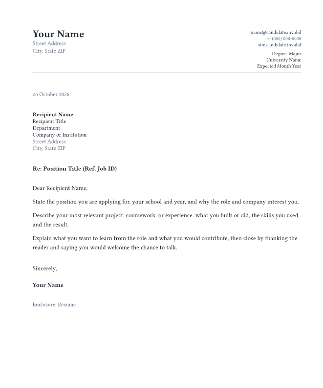
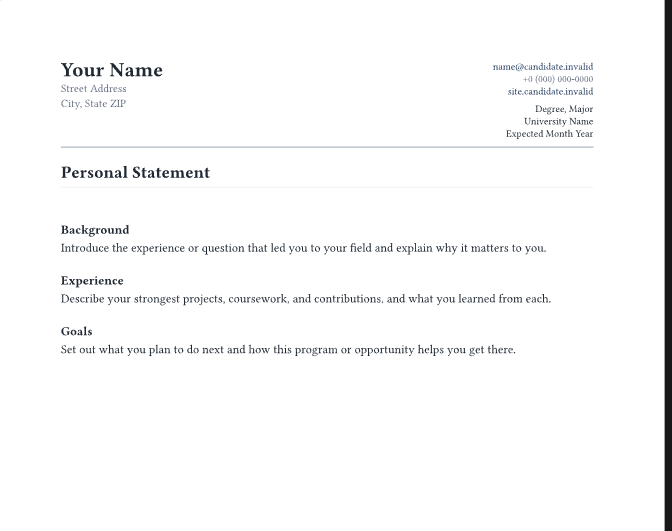

# modernpro-coverletter-plus

An academic-first Typst package for cover letters and research, teaching, or
personal statements. It shares its design system and `profile` shape with
[modernpro-cv](https://typst.app/universe/package/modernpro-cv), so a CV, a
letter, and a statement read as one application while each source file remains
self-contained.

This updates the original modernpro-coverletter with updated address fields 
and makes it more suitable for students.

The default design is intentionally complete. Most users only need to provide
their profile, the recipient, and the letter text.

All examples use explicit Placeholder entities from Exampleland and reserved
`.invalid` domains; none maps to a real person, place, institution, or project.

## Preview

### Academic cover letter

[](screenshots/coverletter.png)

### Research statement

[](screenshots/statement.png)

## Choose a document

| Document | Start from | Best for |
| --- | --- | --- |
| Cover letter | `coverletter.typ` | A role, fellowship, grant, or programme application addressed to a recipient |
| Statement | `statement.typ` | Research, teaching, diversity, service, or personal statements with section headings |

Both documents keep an editable `profile` dictionary at the top of their own
file. Copy the same values when you want matching headers, without adding a
shared-file dependency.

## Quick start

Create and compile a project with the Typst CLI:

```bash
typst init @preview/modernpro-coverletter-plus:1.0.0
cd modernpro-coverletter-plus
typst compile coverletter.typ
typst compile statement.typ
```

The generated project contains:

```plain
modernpro-coverletter-plus/
├── coverletter.typ   <- recipient, letter body, and closing
└── statement.typ     <- title, headings, and statement body
```

Use `typst watch coverletter.typ` or `typst watch statement.typ` for automatic
recompilation while editing.
